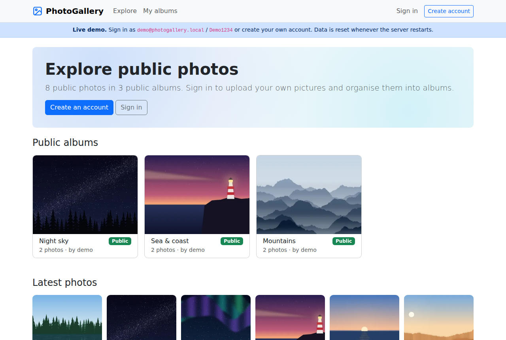
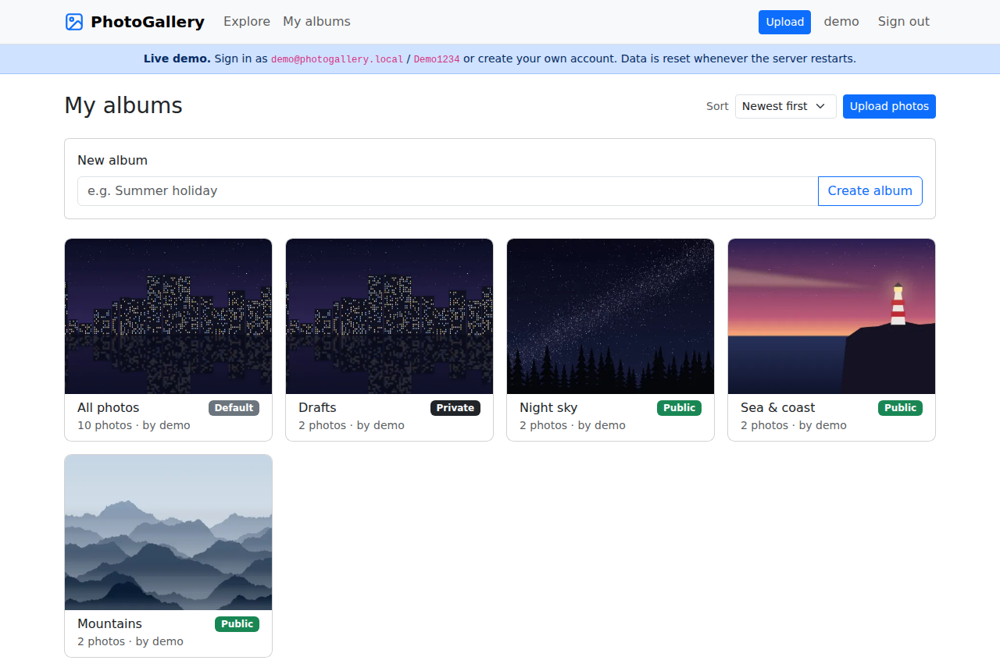
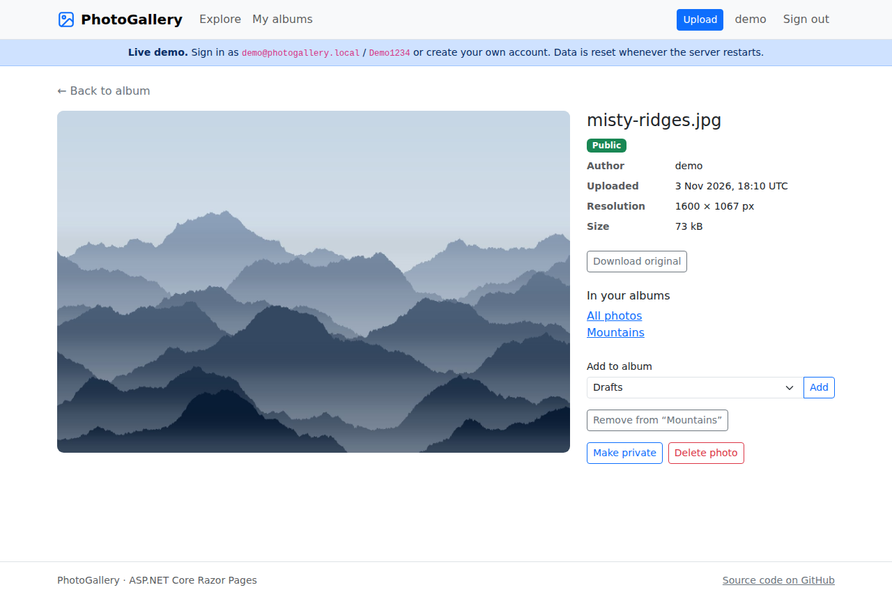
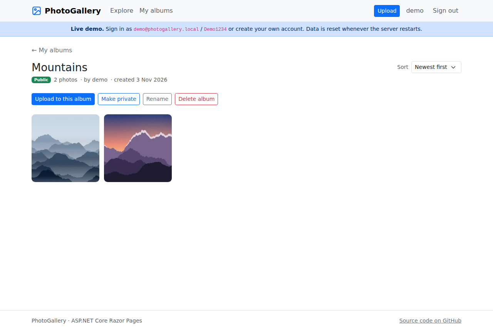
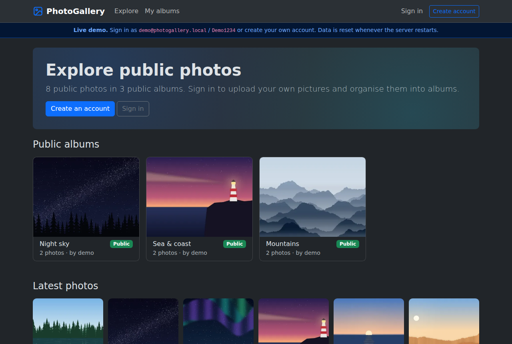
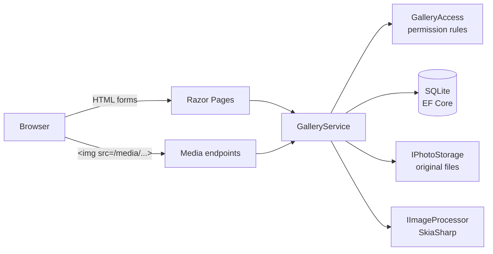
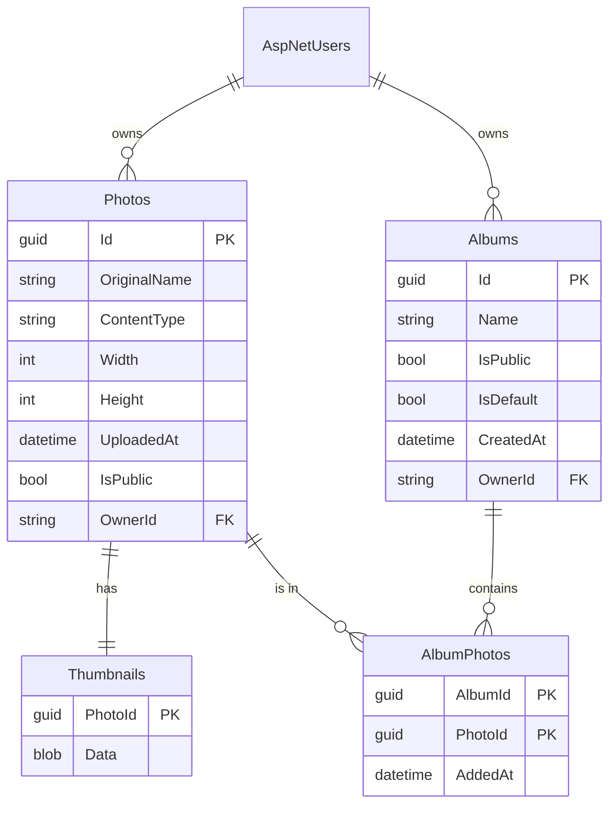

# PhotoGallery

[](https://github.com/PatrikMrnka/PhotoGallery-ASP/actions/workflows/ci.yml)


A photo sharing web application built with **ASP.NET Core Razor Pages**, **Entity Framework Core** and **ASP.NET Core Identity**.
Users upload photos, organise them into albums and decide what is private and what is shared with everyone.

**Live demo: DEMO_URL**
Sign in with `demo@photogallery.local` / `Demo1234`, or create your own account.
The demo runs on a free instance: the first request after a period of inactivity can take about a minute, and all data is reset on every restart.



## Features

- **Accounts** – registration, sign-in, password change, two-factor authentication, personal data download and account deletion (ASP.NET Core Identity).
- **Uploads** – several images at once (JPEG, PNG, GIF, WebP). The real format is detected from the file content, the image is auto-rotated, EXIF metadata including GPS location is removed and a WebP thumbnail is generated.
- **Albums** – every user has a default *All photos* album that automatically contains all their uploads. Custom albums can be created, renamed, sorted and deleted; deleting an album keeps its photos.
- **Sharing** – photos and albums are private by default. Public photos appear on the Explore page and anyone can add them to their own albums. Publishing an album also publishes the owner's photos in it.
- **Explore** – paginated feed of public photos and the latest public albums, available without signing in.
- Responsive layout with automatic light and dark mode.

| My albums | Photo detail |
| --- | --- |
|  |  |
| **Album** | **Dark mode** |
|  |  |

## Tech stack

| Area | Technology |
| --- | --- |
| Web | ASP.NET Core 10 Razor Pages, Minimal API endpoints for image delivery |
| Data | Entity Framework Core 10, SQLite, code-first migrations |
| Auth | ASP.NET Core Identity (cookie authentication, 2FA) |
| Images | SkiaSharp (format detection, orientation, resizing, metadata removal) |
| UI | Bootstrap 5.3, vanilla JavaScript |
| Tests | xUnit, `WebApplicationFactory` integration tests, in-memory SQLite |
| Delivery | Docker, GitHub Actions, Render |

## Architecture



- **Razor Pages** only translate HTTP requests into calls of `GalleryService` and render the result. They contain no data access or permission logic.
- **`GalleryService`** implements all use cases (upload, albums, visibility, deleting). Every query is filtered by the current user, so a page cannot accidentally show something it should not.
- **`GalleryAccess`** is the single definition of who can see what. The same rule exists as an in-memory check and as an expression translated to SQL, and tests verify that both agree.
- **Media endpoints** (`/media/{id}` and `/media/{id}/thumb`) serve images through the same service. A private photo returns `404 Not Found` to everyone except its owner, exactly like a photo that does not exist.
- Original files are stored on disk under a GUID name, thumbnails are stored in their own table so photo lists never load image data.

### Data model



### Security

- Permissions are checked on the server for every page, form and image request; hidden items are indistinguishable from missing ones.
- All changes use `POST` with anti-forgery tokens. Nothing is changed by a `GET` request.
- Uploads are limited by file size, file count, image resolution (protection against decompression bombs) and per-user quota, and the format is detected from the content instead of trusting the browser.
- File names supplied by users are never used as file system paths.
- Public pages show only the part of the e-mail address before `@`.
- Private images are sent with `Cache-Control: private, no-store`.

## Getting started

Requirements: [.NET 10 SDK](https://dotnet.microsoft.com/download/dotnet/10.0).

```bash
git clone https://github.com/PatrikMrnka/PhotoGallery-ASP.git
cd PhotoGallery-ASP
dotnet run --project src/PhotoGallery.Web --launch-profile https
```

Open <https://localhost:7046>. The database is created automatically in `src/PhotoGallery.Web/App_Data`.
In the Development environment the demo account with sample photos is created as well (`demo@photogallery.local` / `Demo1234`).

Screenshots in this README are generated by the [Screenshots workflow](.github/workflows/screenshots.yml) with [`tools/take_screenshots.py`](tools/take_screenshots.py).

Run the tests:

```bash
dotnet test
```

### Docker

```bash
docker build -t photogallery .
docker run -p 8080:8080 -e Demo__Enabled=true -v photogallery-data:/app/App_Data photogallery
```

The application is then available at <http://localhost:8080>. The volume keeps the database and uploaded photos between restarts.

### Configuration

All settings live in `appsettings.json` and can be overridden by environment variables (`Section__Key`).

| Setting | Default | Description |
| --- | --- | --- |
| `ConnectionStrings:DefaultConnection` | `Data Source=App_Data/photogallery.db` | SQLite database file |
| `Storage:Path` | `App_Data/uploads` | Folder for original photo files |
| `Upload:MaxFileBytes` | `15728640` (15 MB) | Maximum size of one file |
| `Upload:MaxFilesPerRequest` | `20` | Maximum number of files in one upload |
| `Upload:MaxPhotosPerUser` | `0` (unlimited) | Photo quota per user |
| `Upload:MaxPixels` | `40000000` | Maximum image resolution |
| `Upload:ThumbnailSize` | `480` | Longest side of thumbnails in pixels |
| `Demo:Enabled` | `false` | Creates the demo account and shows the demo banner |
| `Demo:ResetOnStartup` | `false` | Deletes all data on startup |

### Database migrations

```bash
dotnet tool restore
dotnet ef migrations add <Name> --project src/PhotoGallery.Web --output-dir Data/Migrations
```

Migrations are applied automatically when the application starts. The CI pipeline fails if the model changes without a migration.

## Deployment

The live demo is hosted on [Render](https://render.com) using the [`render.yaml`](render.yaml) blueprint and the [`Dockerfile`](Dockerfile).
To deploy your own copy, create a new *Blueprint* in the Render dashboard and select this repository; every push to `main` is deployed automatically.
Any other container host works too – mount a persistent volume at `/app/App_Data` to keep data.

## Project structure

```
src/PhotoGallery.Web/
├── Data/           EF Core DbContext, migrations, startup initialisation and demo seeding
├── Endpoints/      Minimal API endpoints that serve images
├── Models/         Entities (Photo, Album, AlbumPhoto, PhotoThumbnail, ApplicationUser)
├── Options/        Strongly typed configuration
├── Pages/          Razor Pages (Explore, Albums, Photos, shared layout and partials)
├── SeedData/       Sample images for the demo account
├── Services/       GalleryService, permission rules, image processing, file storage
└── wwwroot/        CSS, JavaScript, vendored Bootstrap and jQuery
tests/PhotoGallery.Tests/
├── GalleryServiceTests.cs     Use cases and permission rules against SQLite
├── ImageProcessorTests.cs     Format detection, metadata removal, thumbnails, limits
└── WebApplicationTests.cs     HTTP-level tests of the running application
```

## History

The application started in 2022 as a school assignment in a web programming course (ASP.NET Core 6, SQL Server LocalDB).
The original version is preserved under the tag [`v1.0-school`](https://github.com/PatrikMrnka/PhotoGallery-ASP/tree/v1.0-school).

In 2026 I revived and modernised it:

- upgraded from .NET 6 (out of support) to .NET 10 and replaced SQL Server LocalDB with SQLite, so the project runs anywhere with a single command;
- fixed security issues of the original version – images and private albums of other users were reachable by URL, a permission check could be bypassed by changing a query parameter, and an album could be deleted by a `GET` request;
- moved the business logic from page handlers into a tested service layer with a single set of permission rules;
- implemented real thumbnails, metadata removal and upload limits;
- replaced the scaffolded Identity pages with the built-in Identity UI, redesigned the interface and translated it to English;
- added automated tests, a CI pipeline, a Docker image and a public live demo.

## License

[MIT](LICENSE). The sample images in `SeedData` are procedurally generated by [`tools/generate_seed_images.py`](tools/generate_seed_images.py).
